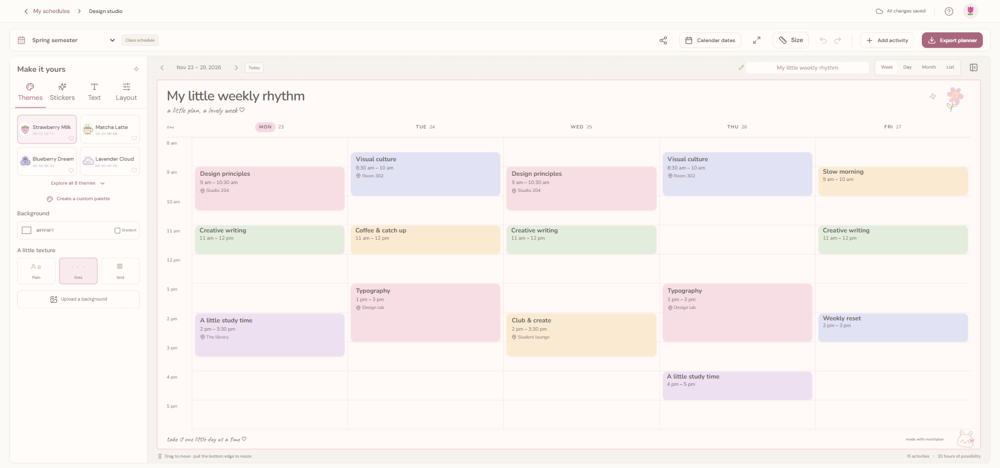
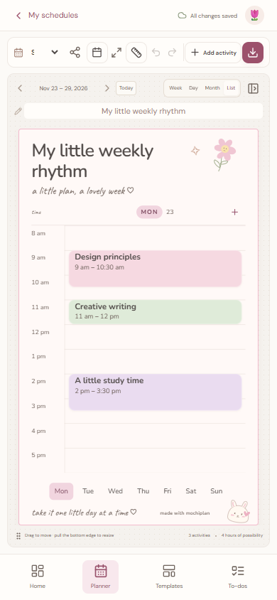
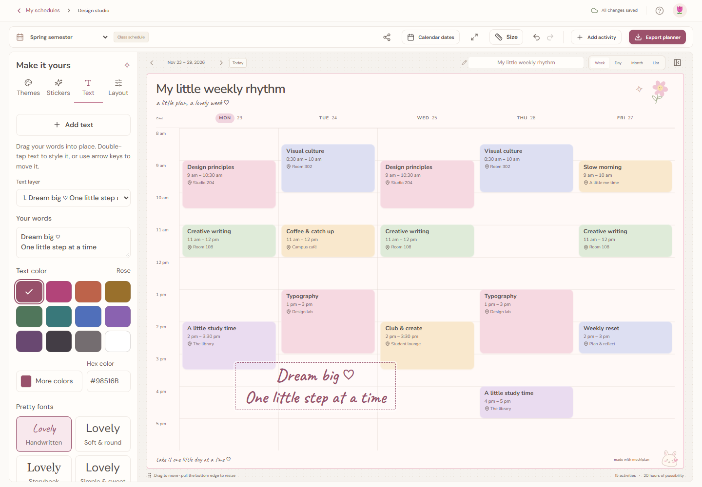
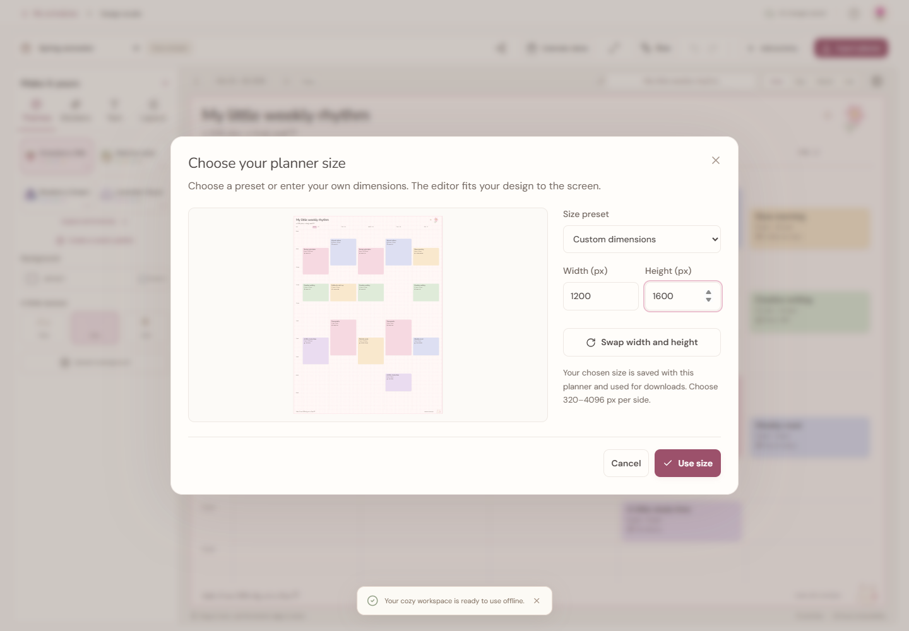

# MochiPlan

MochiPlan is a cute, customizable schedule planner and installable PWA. Design your calendar with pastel themes, illustrated stickers, pretty fonts and photo backgrounds, then download your planner as a PNG, JPG or PDF. Editing works offline, with optional accounts for syncing across devices.

[Run locally](#install-and-run) · [Features](#features) · [Screenshots](#screenshots) · [Frontend guide](./frontend/README.md) · [Backend guide](./backend/README.md)

## Features

- **Flexible calendars:** week, day, month and list views; semester dates, holidays, one-off exams and cancelled classes. Edit one occurrence, future dates or an entire series.
- **A design studio:** eight built-in palettes, custom colors, illustrated stickers, decorative text with font and color controls, and adjustable photo backgrounds.
- **Custom planner sizes:** Desktop, Tablet, Phone, Square, A4 and custom pixel dimensions, with a live preview and orientation swap. Downloads use your saved proportions.
- **Clean exports:** PNG, JPG and PDF downloads of your designed calendar, with standard A4 PDF pages for A4 presets.
- **Tasks and reminders:** subtasks, recurring tasks, deadline alerts and optional server-scheduled push notifications.
- **Offline editing and sync:** automatic local saving, Undo/Redo, optional accounts, cross-device sync and individual conflict review.
- **Backups and sharing:** automatic server backup history and read-only planner links with optional passwords and expiration dates.

## Screenshots

Screenshots show sample schedules in the current interface. Select an image to view it at full size.

### Desktop design studio

Edit a weekly calendar while choosing themes, stickers, text and layout settings.



<details>
<summary>Mobile daily planner</summary>

The phone layout opens a daily calendar with touch navigation and design tools available from the toolbar.

<a href="./docs/screenshots/editor-mobile.png"></a>

</details>

<details>
<summary>Decorative text and color controls</summary>

Add your own words, choose a font and color, and drag the text into position on your calendar.



</details>

<details>
<summary>Custom planner dimensions</summary>

Preview a preset or enter a custom width and height before applying the size to your planner and downloads.



</details>

## Project structure

The project has two application folders:

```text
MochiPlan/
├── frontend/       React + TypeScript PWA, editor, exports and offline storage
├── backend/        Node.js API and persistent SQLite server backups
├── docs/           Website screenshots used in this README
├── dev.mjs         Starts both parts or the combined production server
├── package.json    Commands for the whole project
└── package-lock.json
```

Use Node.js 24 or newer. Run commands from the repository root (the folder containing this README).

## Install and run

```powershell
npm install
npm run dev
```

Open **http://127.0.0.1:5173/**. This starts the frontend on port 5173 and the API on port 3001. Vite forwards `/api` requests to the backend. Stop both with **Ctrl+C**.

## Run the production build locally

```powershell
npm run build
npm run preview
```

Open **http://127.0.0.1:4173/**. The backend serves the built frontend and its API from the same address. This preserves browser-local plans previously saved at that exact address. Keep using the same hostname and port to access existing IndexedDB data.

`npm start` also serves the production build. To change its port in PowerShell, set `$env:PORT='8080'` first.

## Data

Normal editing saves automatically to IndexedDB and works offline. **Automatic server backups** are enabled by default in **Settings → A little server backup**. While MochiPlan is open and the backend is available, edits back up after a short pause, at most once a minute. Failed backups retry with backoff and on reconnection. Settings shows the last successful server backup, including after a reload, and lets you turn automation off or save manually.

**Backup history** keeps the latest 30 server versions with timestamps and planner/activity/task counts. Choose a version to restore after confirmation. Restoring first creates a local safety copy; server restores also preserve current plans as a server version before making the selected version the latest. The local safety copy remains available offline in Backup history. A conflicting server version pauses automatic writes until you review history, restore a version, or explicitly save this workspace manually.

Backups include planners, activities, semester dates, holidays, cancelled/rescheduled occurrences, designs, tasks and preferences. Identical automatic backups do not create extra versions; navigating between planners does not count as an edit. File backup/export controls remain available offline. Automatic-backup preferences apply to this browser and are separate from restored workspace preferences.

The backend stores data in `backend/data/mochiplan.sqlite`, which Git ignores. Device-only workspaces use a random browser workspace key; the server stores its hash. Each account has a separate synced workspace and each local profile has separate backup/reminder settings. Clearing site data removes local plans, cached account edits and device backup keys, so download a backup first. Server backups require the backend to be running. Backups run while the app is open; browser background timers may delay them.

## Shareable planners

Choose **Share planner** in the studio, or the share icon on a saved planner. Create a read-only link for anyone with the link, or protect it with a separate password of at least 12 characters. Links expire in seven days by default; choose one day, 30 days, a date/time within the next year, or no expiration. Copy the complete link, including the part after `#`.

Each link contains a saved copy of **one planner**, including its calendar rules, artwork and uploaded background. Locations, instructors and notes are excluded by default and can be included explicitly. Tasks, account details, preferences unrelated to the calendar, and other planners are excluded. **Edit link → Update shared copy** publishes your current planner and chosen access settings to the same link. Later local edits do not publish automatically. Changing a link password invalidates previous viewer access grants.

Recipients can browse week, day, month and list views without an account or editing controls. Shared content needs an online connection and is not cached for offline access. Expiration and revocation are enforced by the server; open viewers check again every 30 seconds while visible, on focus/reconnection, and at expiration. People can keep content they already viewed, so revocation cannot erase their saved copies.

Use **Settings → Manage shared links** to review or revoke every link in the current workspace, including links whose original local planner was removed or replaced. Account links can be managed from any signed-in device; device-only links are managed using this browser’s workspace key. Deleting an account also deletes its shared copies. Up to 20 unrevoked links can be kept per workspace; revoke old links to create more.

For someone on another device to open a link, the app and `/api` must use the same reachable server. Host behind HTTPS and configure its public origin as described below. A localhost link only works on the computer serving it.

## Optional accounts and cross-device sync

Open **Settings → Your plans, wherever you are** to create a username/password account or sign in. No email service is required. Usernames use 3–32 letters, numbers or underscores; passwords use at least 12 characters. Save the recovery code shown once after sign-up. **Recover account** resets a forgotten password, replaces that code and signs out existing sessions.

A new account copies this device’s current plans. Signing into an existing account opens its plans and retains the device-only workspace separately. Sign-out returns to those device-only plans and keeps the account’s local cache for later offline use. Multiple accounts keep separate local caches. Account sessions use HttpOnly cookies; passwords are salted and hashed on the server.

Choose **Manage account** in Settings to change your password, review signed-in devices, sign out one session, or sign out every other session. Device names are estimated from browser details; last-active times update at most once per minute. Changing a password requires the current password, replaces the recovery code, and signs out other sessions. Revoked sessions lose account and account-linked backup access, and their linked background reminders stop. Already saved offline copies remain on those devices.

**Delete account** requires the current password and your exact username. Download a backup from the dialog first if you want to keep your plans. Deletion removes the account, its sessions, account backup history, linked device server backups and reminders, and its local cache on this device. Separate device-only plans remain. Other devices’ offline copies and previously downloaded files cannot be erased remotely. Password changes, session management and account deletion require a server connection.

Sync runs after edits settle, on reconnection/focus, and checks for account updates about every 15 seconds while the app is open. The editor header distinguishes **Saved locally** from **Synced**. **Sync this device** can be paused independently. Offline edits survive reloads and upload after reconnecting and signing in if the session expired.

Enabled background reminders link to the account. A successfully synced schedule updates reminder jobs on every linked device even when those apps are closed; each device retains its time zone and reminder lead time. Account schedule changes and reminder-job invalidation commit together so a cancelled class cannot remain queued from an older account version. Local changes still need to reach the account before other devices or their reminder jobs can use them.

Changes to separate tasks, planners, settings or activity series merge automatically. Overlapping changes open **Bring your changes together**, with the original, device and account values for each changed field, including dates, times and cancellations. Choose **Use this device**, **Use account**, or **Keep both** for each conflict. Keeping both copies only the chosen activity or task; linked recurring occurrences stay together. Settings that require one value offer the first two choices. Bulk choices affect unresolved items only, and other activity/task changes can be expanded for review.

All conflicts must be resolved before applying the combined result. If either device’s shared plans change during review, the comparison refreshes and requires new choices. With no common saved version, one-sided items are treated as additions and require review before combining. Invalid calendar combinations are resolved together for the affected planner; supported storage limits are checked before applying. A previous local workspace is kept in **Backup history** before incoming changes are applied. Incoming sync waits while an edit form or conflict review is open, and local-only uploads preserve undo history. Navigation, notification permission/reminder choices, backup settings and push subscriptions remain device-local.

Both devices must use the **same reachable MochiPlan server**. `localhost` on a phone refers to the phone, so a computer’s localhost preview is only for local testing. For phone/computer use, host the Node server behind HTTPS, persist `backend/data`, set `HOST=0.0.0.0` when needed, add the public origin to `ALLOWED_ORIGINS`, and set `ACCOUNT_SECURE_COOKIES=true` in production. Keep the site and `/api` on the same origin. The app still runs without creating an account.

## Tasks, subtasks and repeats

Open **Little to-dos → Add a to-do**, or edit an existing task. Add up to 100 subtasks, check off steps directly in the list, and see progress for each task. Completing a parent finishes all its steps; unchecking a step reopens the parent. Step checks alone do not automatically complete the parent.

Choose **Repeat** daily, weekly or monthly, every 1–99 periods, with an optional inclusive end date. A deadline is required. Completing a repeat keeps that occurrence in **Little wins**, creates the next copy and resets its steps. Overdue repeats skip missed dates and advance to the next future scheduled date. Monthly repeats preserve their original day, using the last day of shorter months and returning to the original day afterward. Already created copies keep their own settings. Unchecking a completed occurrence retains its next copy; completing it again does not create a duplicate. Choose **Does not repeat** on the pending copy to stop it, or delete that copy. Deleting one occurrence does not delete other copies.

Choose a **Deadline notification** at the deadline, 15/30 minutes, one hour or 24 hours before. An optional deadline time uses this device’s local time zone; alerts without a time use 9:00 am. Enable **gentle reminders** for alerts while open, or **background reminders** in Settings for delivery with the app closed. Each task opts in separately. Completed and deleted tasks stop contributing alerts after their changes sync. Offline changes must reach the server before closed-app reminders can use them; previously delivered notifications cannot be recalled.

Tasks, subtasks, repeat settings and selected alerts save offline, travel in backups and sync with optional accounts. Concurrent completion uses stable IDs for the next copy. Overlapping edits to a repeating task series pause for a conflict choice; different subtasks of an ordinary task can merge independently. Notification permission and background opt-in remain device-local. Selecting a task notification opens its task editor; a reminder for another workspace asks you to switch to that workspace.

## Background reminders

Install the updated dependencies with `npm install`. Before starting the server, set a real Web Push contact address in PowerShell:

```powershell
$env:VAPID_SUBJECT='mailto:your-real-email@example.com'
npm run build
npm run preview
```

Replace the example email with your contact address. Open **http://127.0.0.1:4173/**, then **Settings → A nudge, even when you’re away → Enable background reminders** and allow notifications. Use **Send a test reminder** to check this device. The server generates signing keys once in the ignored `backend/data/push-keys.json`; retain that file with your SQLite data across restarts. An existing deployment can instead supply `VAPID_PUBLIC_KEY` and `VAPID_PRIVATE_KEY`.

Keep the server running with internet access. After the reminder schedule has synced, notifications can arrive with MochiPlan closed. Production hosting needs HTTPS; localhost works for testing. On iPhone or iPad, install the Home Screen app and enable reminders from there. Delivery can be delayed by device settings or connectivity.

Each device opts in separately and uses its own time zone. The server respects semesters, holidays, cancellations and all edit scopes. Reminder sync is independent of automatic backups and uploads only activity timing, titles, locations, calendar rules, and pending opted-in task titles/deadlines. Subtask contents are excluded. Settings shows the last successful schedule sync and last reminder accepted by the push service. Offline edits must sync before the server can use them. Turning reminders off unsubscribes the device immediately and retries server cleanup after reconnection.

**Reminders while open** remain available as an optional local fallback. Push and local reminders use matching IDs to avoid duplicate nudges. The worker opens the relevant planner/date or task when a notification is selected, preserving any separate shared-planner tab. Server jobs and recent delivery IDs persist across restarts; temporary errors retry briefly, expired subscriptions require reconnecting, and reminders more than five minutes overdue are skipped.

## Checks

Account tests use separate browser contexts for phone and computer, including offline reloads, three-way merging, keep-both conflict resolution, profile isolation and recovery. Server tests cover session/CSRF checks, account isolation, expiry, rate limits and atomic account/reminder updates. No real user accounts are created by the tests.

```powershell
npm test
npm run build
npm run test:e2e
```

These run the frontend unit tests, backend persistence/API tests, production build, and Chrome browser tests. Browser tests use an installed Google Chrome and port 4173. Server-backup and reminder integration tests use isolated in-memory databases. Reminder tests simulate push-provider acceptance and Chrome push delivery, including delivery with no MochiPlan page open, worker deduplication, cancellation sync, offline unsubscribe and expired-subscription reconnection. Real browser push-provider delivery and physical iOS/Android device behavior still need testing on the target device.

For reproducible dependency installation, use `npm ci` at the project root. The root lockfile describes both npm workspaces.

`MochiPlan-production.tar.gz` contains the frontend static build. The full application, including server backups, runs through the Node commands above.

See [frontend documentation](./frontend/README.md) for the planner’s features and [backend documentation](./backend/README.md) for the API.
